<div align="center">

# eDiscovery Search Request

**Ask for a Microsoft Purview eDiscovery search without knowing any search syntax.**

Two apps that work together:

**The request builder** (web and desktop): staff answer a few plain-language questions, and it saves a
`.req` request file holding the KeyQL query. Nothing they type leaves their device.

**The search runner** (desktop, for the eDiscovery administrator): opens the `.req` file, signs the admin in
to Microsoft 365, and creates and estimates the search in Microsoft Purview, recording every step in a
tamper-evident audit log.

[](LICENSE)


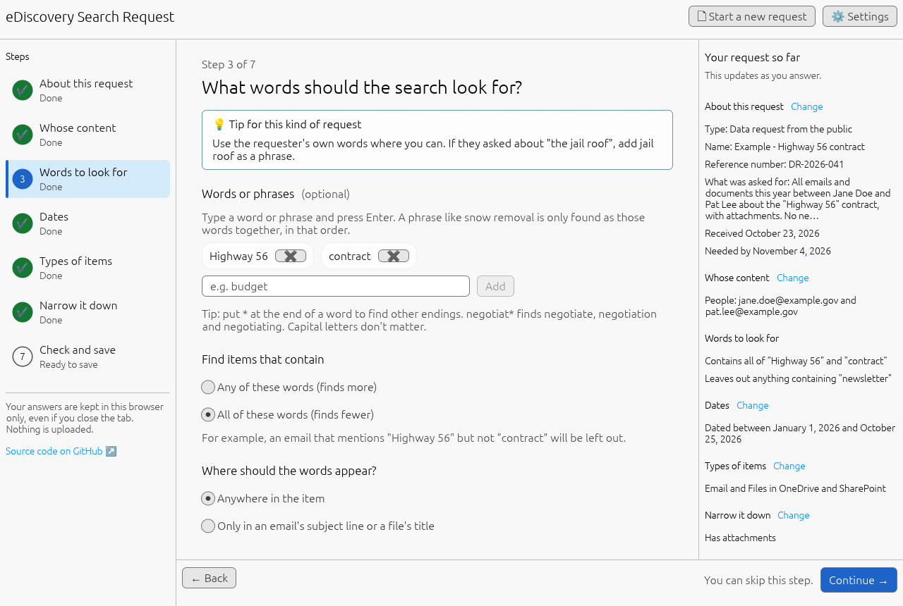

</div>

---

## Contents

- [Why](#why)
- [What it does](#what-it-does)
- [A tour](#a-tour)
- [Privacy: nothing leaves your device](#privacy-nothing-leaves-your-device)
- [The file it makes](#the-file-it-makes)
- [The search runner](#the-search-runner)
- [Setting up the search runner](#setting-up-the-search-runner)
- [How answers become KeyQL](#how-answers-become-keyql)
- [Checks](#checks)
- [Design basis](#design-basis)
- [Getting started](#getting-started)
- [Hosting the web version](#hosting-the-web-version)
- [Project layout](#project-layout)
- [License](#license)

## Why

Purview's search box expects KeyQL: `participants:`, `kind:`, date ranges, upper-case operators,
quoted phrases. The people who need a search usually don't know it: a Responsible Authority answering a
data practices request, HR, an attorney's office, a department head. The person who does know it ends up translating emails like
"everything Jane sent about the Highway 56 contract this year, but not the newsletters" by hand.

This app does that translation. Staff never see the query. They see a plain-English summary of
what they asked for, and whoever runs the search gets an exact, repeatable query.

## What it does

- **A seven-step wizard** with one question per page and a step list you can jump around in.
- **Nothing is required up front.** Every question is optional and explained in plain words. Unnamed requests are named after their type and date.
- **Starts with the kind of request:** a data request from the public, someone asking for data about themselves, a lawsuit or legal hold, a personnel matter, or something else. Each kind gets short, practical tips on the pages where they help.
- **Paste the request and let the app pick out the details.** Email addresses, phrases in quotes and dates (`3/31/2026`, `March 31, 2026`…) are offered as tick boxes. Nothing is added until you choose **Use these**.
- **The Minnesota deadline, worked out for you.** For someone asking for data about themselves, enter the date the request came in and the app shows the date to respond by (see [below](#the-minnesota-10-business-day-deadline)).
- **"Your request so far"** stays in view beside every page, in plain English, with **Change** links.
- **Names are fine.** If you only know a person's name, type the name. The IT Director looks up the mailbox.
- **A check-your-answers page** that summarizes the request in plain English, with **Change** links.
- **Problems are explained, not just flagged.** Each problem has a link that takes you to the step to fix it.
- **Saves one `.req` request file** named after the request and the date, ready to attach to an email. It holds every answer, the plain-English summary and the exact KeyQL query.
- **Writes the email for you.** It opens your mail program with the To, Subject and body filled in, or copies the text.
- **A copy for your records.** One click saves a text file with what was asked for, the plain-English summary and the exact search.
- **Remembers your answers** if you close the app, so a half-finished request isn't lost.
- **Text size and color settings:** Standard, Large or Extra large text, and light, dark or match-my-computer colors.
- **Runs anywhere:** a native app for Windows, macOS and Linux, and the same app in a browser tab via WebAssembly.

## A tour

| | |
|---|---|
| 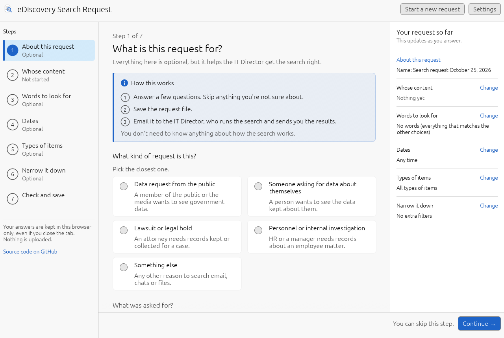 | 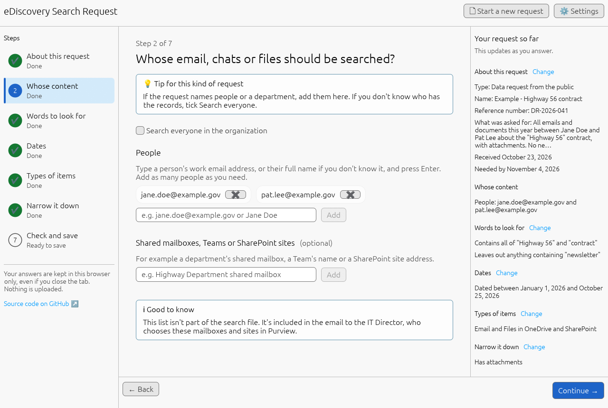 |
| **1. About this request.** Pick the kind of request, paste what was asked for, and optionally add a name, a reference number, the date received and a deadline. | **2. Whose content.** Work email addresses of the people to search, or shared mailboxes and sites, or "Search everyone". |
|  | 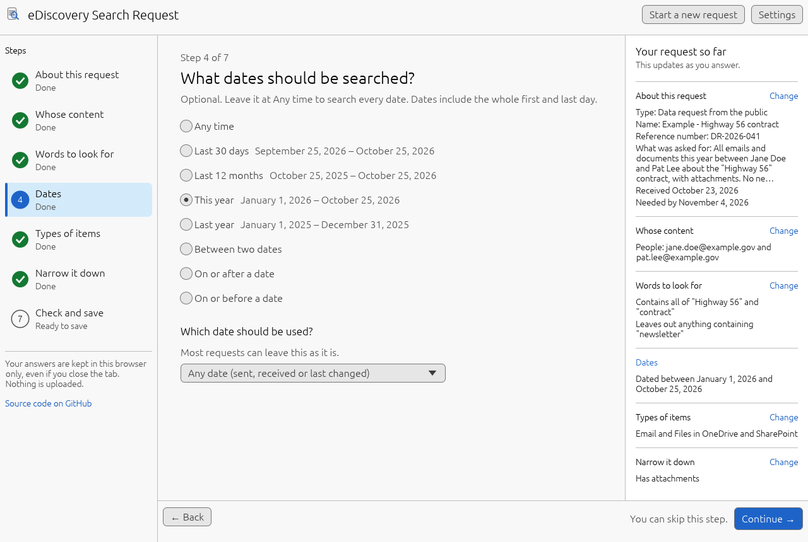 |
| **3. Words to look for.** Words and phrases as chips, "any" or "all", where they should appear, words to leave out, and words close together. | **4. Dates.** Any time, Last 30 days, Last 12 months, This year, Last year, or your own dates (typed as MM/DD/YYYY or picked from a calendar). |
| 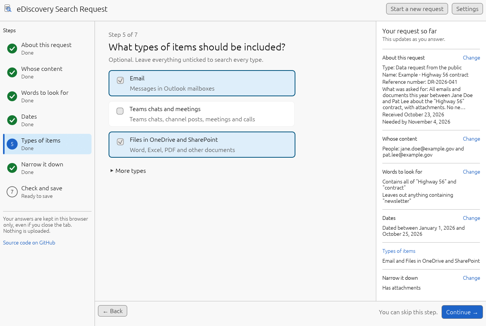 | 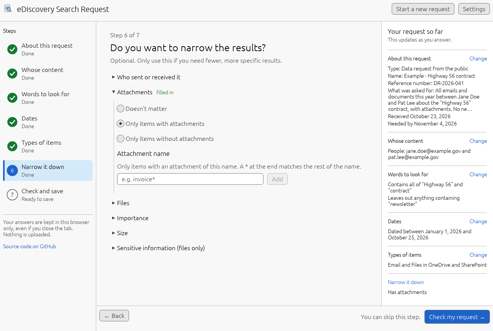 |
| **5. Types of items.** Email, Teams chats and meetings, or files in OneDrive and SharePoint. More types are listed below. | **6. Narrow it down.** Sender and recipients, attachments, file types and names, authors, importance, size, sensitive information. |
| 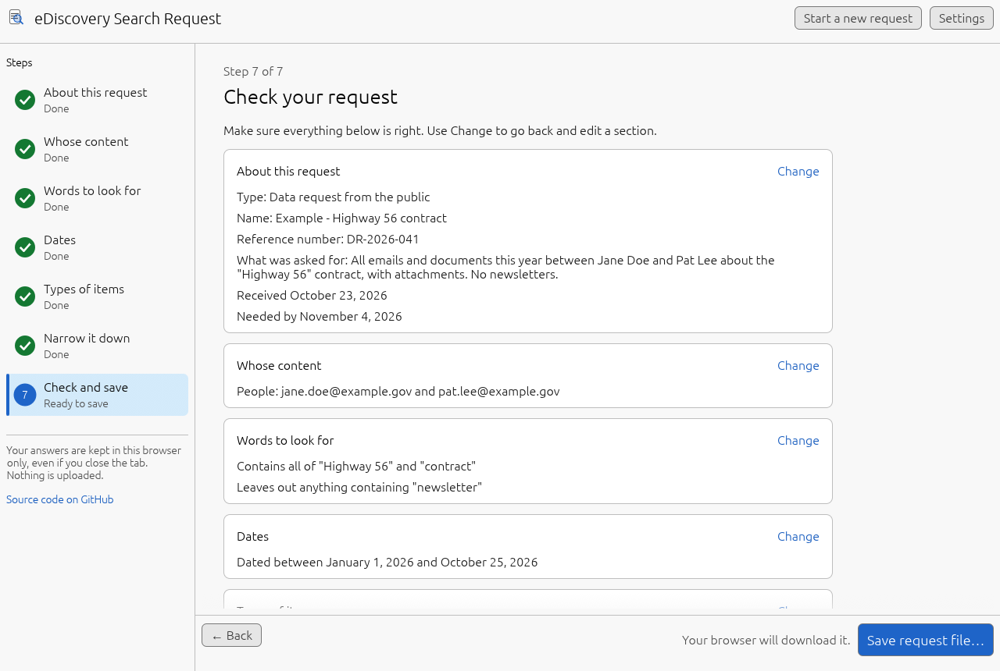 | 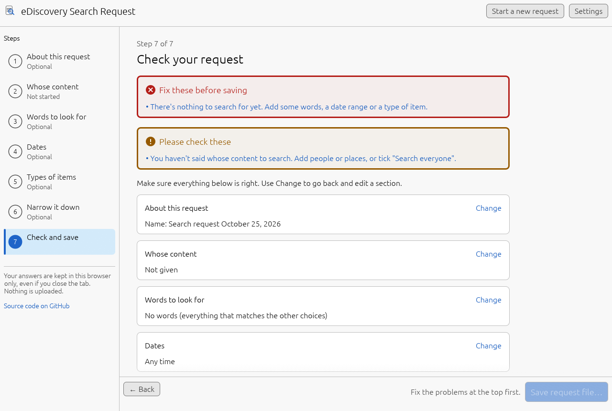 |
| **7. Check and save.** A plain-English summary of the whole request, with Change links, and **Save request file…** at the bottom right, where Continue is on every other step. | **Problems block saving until they're fixed**, and warnings ask for a second look. Every one links to its step. |
| 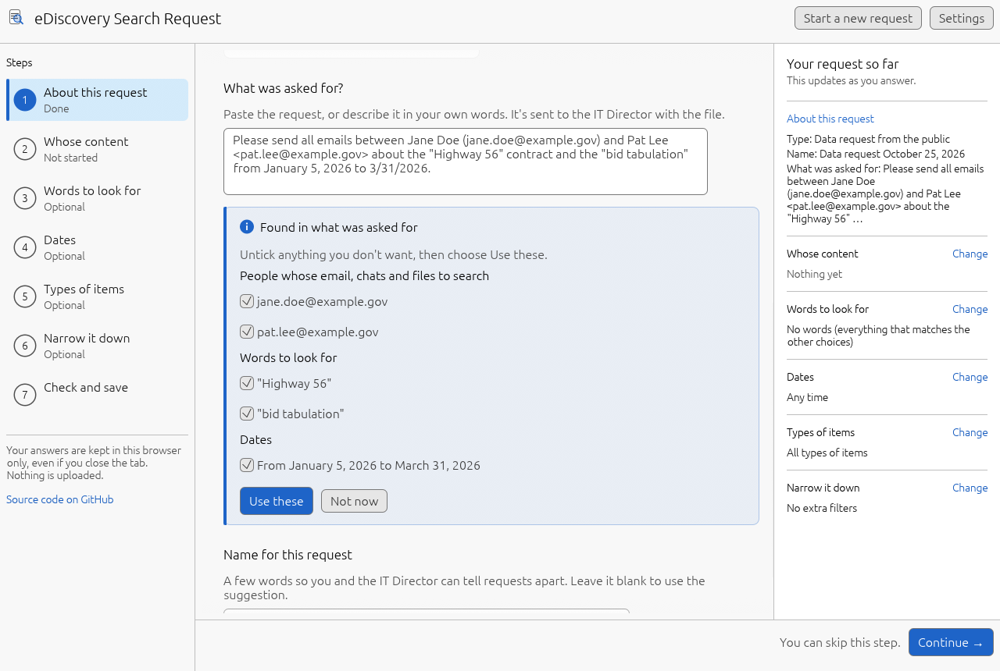 | 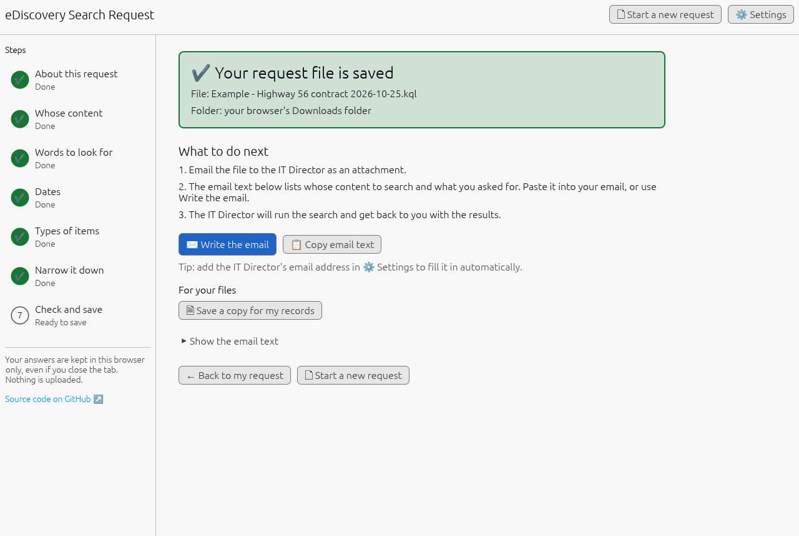 |
| **Paste the request.** The app picks out email addresses, quoted phrases and dates, and you tick the ones to use. | **Saved.** What to do next, **Write the email**, **Copy email text** and **Save a copy for my records**. |
| 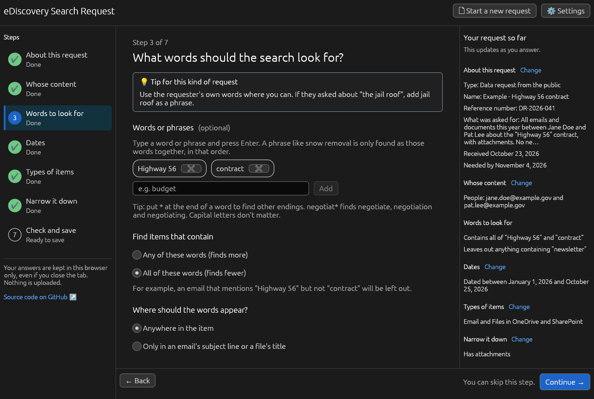 | |
| **Dark colors**, or match the computer's setting. | |

## Privacy: nothing leaves your device

eDiscovery requests are sensitive: who is being searched, and for what. The app is built so that none of it
goes anywhere:

- **No networking code.** The app makes no network requests at all. In the browser it downloads its own files once and that's it.
- **Locked down in the browser.** The page's Content-Security-Policy only allows it to load its own files (`connect-src 'self'`), so even a future change couldn't quietly send data elsewhere.
- **The file is made on your device.** On the desktop it's written where you choose. In the browser it's created in the tab and downloaded.
- **Pasted requests stay local too.** Picking out addresses, phrases and dates is plain pattern matching inside the app. No AI service or server sees the text.
- **Answers stay local.** They're saved in the app's own data folder on the desktop, or in that one browser's local storage on the web.
- **Email stays yours.** "Write the email" only opens a `mailto:` link in your own mail program, and you attach the file yourself.

The web version shows this while it loads:

<p align="center">
  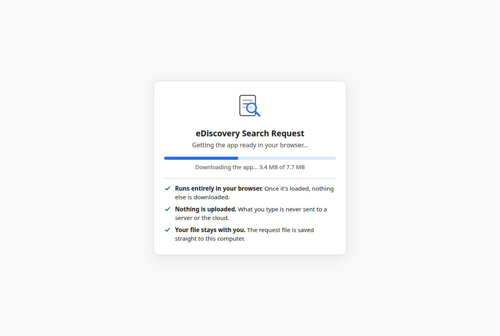
  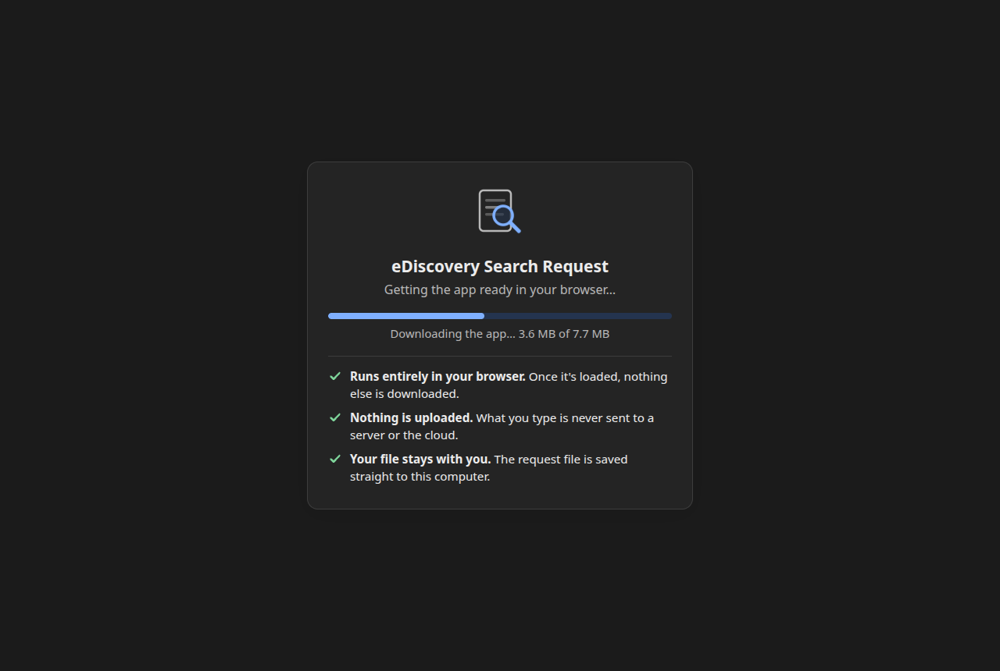
</p>

## The file it makes

**Save request file…** writes one binary `.req` file. The sample request (`--example` on the desktop,
`?example` in the browser) is in [`docs/example.req`](docs/example.req).

**For the eDiscovery administrator:** open it with the [search runner](#the-search-runner), which shows the
whole request, creates the search in Purview and runs the estimate. The builder can't open request files.
For the sample request the query is:

```text
("Highway 56" AND contract AND (sent:2026-01-01..2026-10-25 OR received:2026-01-01..2026-10-25 OR LastModifiedTime:2026-01-01..2026-10-25) AND (kind:email OR kind:docs) AND HasAttachment:true) NOT newsletter
```

The people and places to search are in the file alongside the query: Purview takes them separately, as data
sources.

### Format

| Offset | Size | Contents |
|---|---|---|
| 0 | 8 | `KEYQLREQ` |
| 8 | 2 | Format version, little-endian (currently 1) |
| 10 | 4 | Payload length N, little-endian |
| 14 | N | Payload: the answers, the summary, the query, the save date, the office holidays used for the deadline, and the app version, encoded with [postcard](https://github.com/jamesmunns/postcard) |
| 14 + N | 4 | CRC-32 (the zip/PNG checksum) of every byte before it, little-endian |

- **The query and summary are fixed when the file is saved,** so "Last 30 days" means the same dates however
  late the file is opened.
- **A damaged or altered file is refused:** a changed byte fails the checksum, and the app says the file can't
  be trusted and should be sent again. A file from a newer version of the app says so.
- **It isn't encrypted.** Anyone with the app can read it, the same as an email. Send it the way you'd send any
  other data request.

The code is in [`src/reqfile.rs`](src/reqfile.rs).

## The search runner

A separate desktop app for the eDiscovery administrator. It isn't part of the web app and can't be reached
from the request builder.

| | |
|---|---|
| 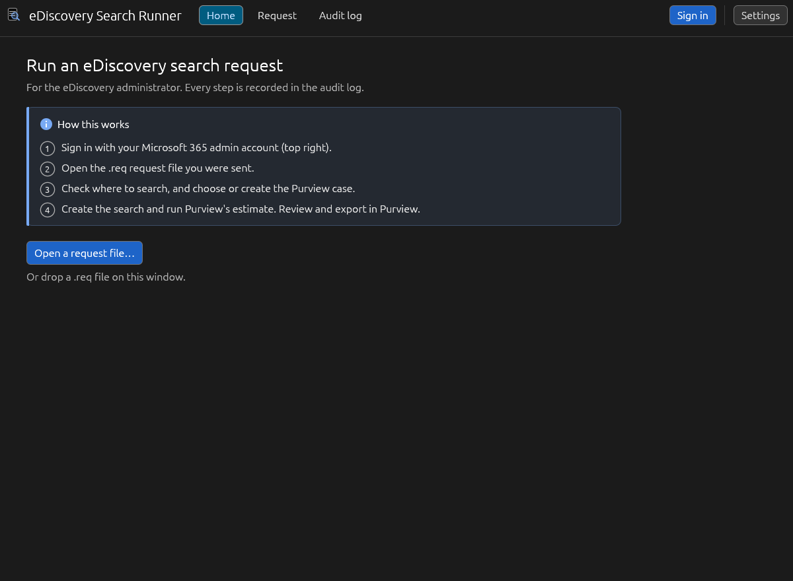 | 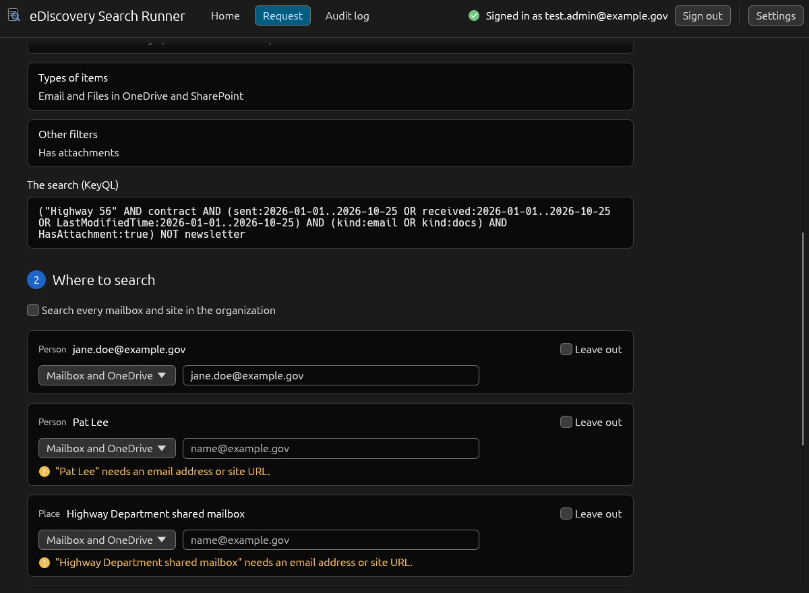 |
| **Sign in and open the request.** The admin signs in with their Microsoft 365 account and opens (or drops) the `.req` file. The file's integrity and SHA-256 are shown and logged. | **Where to search.** Email addresses and SharePoint URLs from the request are filled in. Names ("Pat Lee") and descriptions ("Highway Department shared mailbox") must be given a real address or left out on purpose. |
| 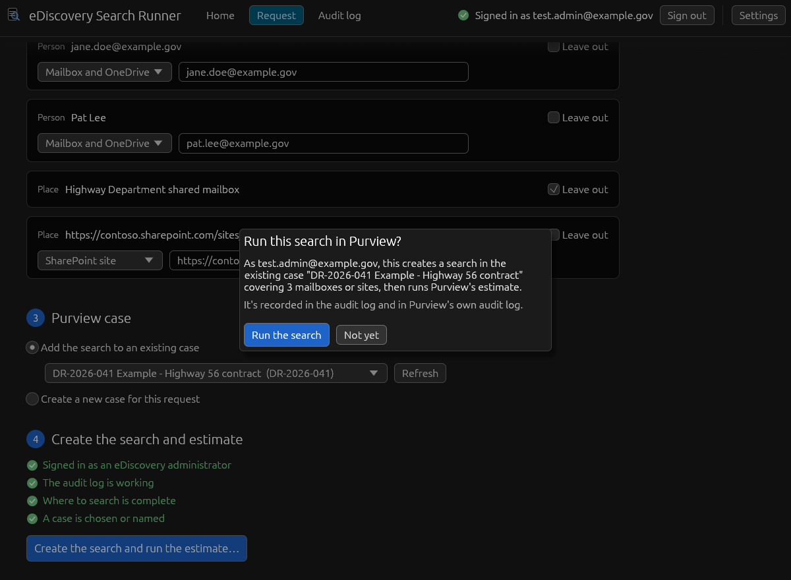 | 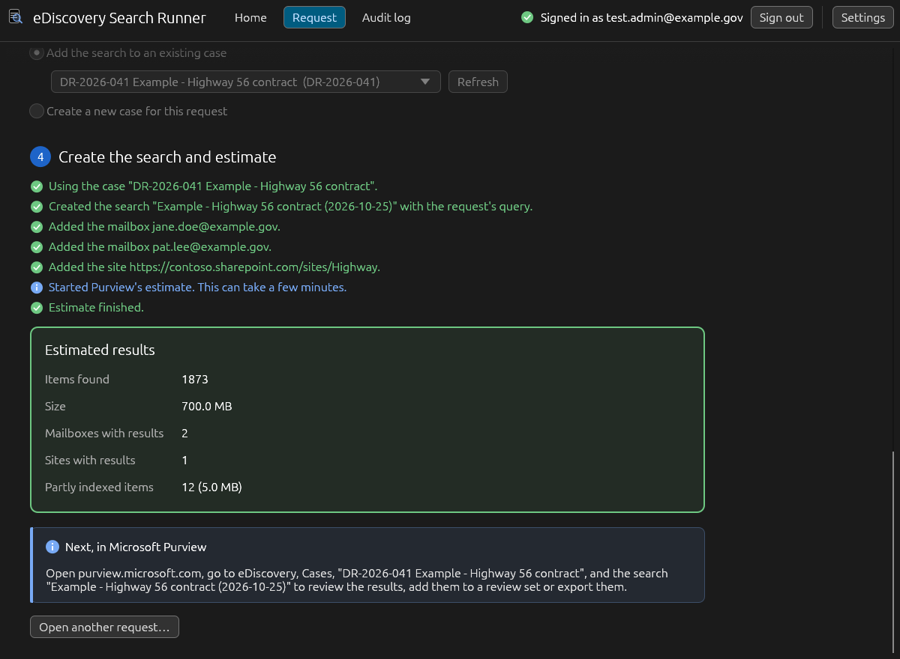 |
| **Choose or create the case, then confirm.** Pick an existing eDiscovery case or create one named after the request and its reference number. | **Create and estimate.** The runner creates the search with the request's exact query, adds each mailbox and site, runs Purview's estimate and shows the counts. Review and export continue in Purview. |

### What it does in Purview

Through the Microsoft Graph eDiscovery API, as the signed-in admin:

1. Creates a case (with the request's reference number as its external ID), or uses the one chosen.
2. Creates a search named after the request and its save date, with the request's KeyQL as the query and what was
   asked for as the description. "Search everyone" becomes every mailbox and site in the tenant.
3. Adds each mailbox (with its OneDrive) and each SharePoint site.
4. Runs Purview's estimate and waits for it: items, size, mailboxes and sites with results, partly indexed items.

It stops there on purpose. Reviewing, holds, review sets and exports stay in the Purview portal.

### The audit log

<p align="center">
  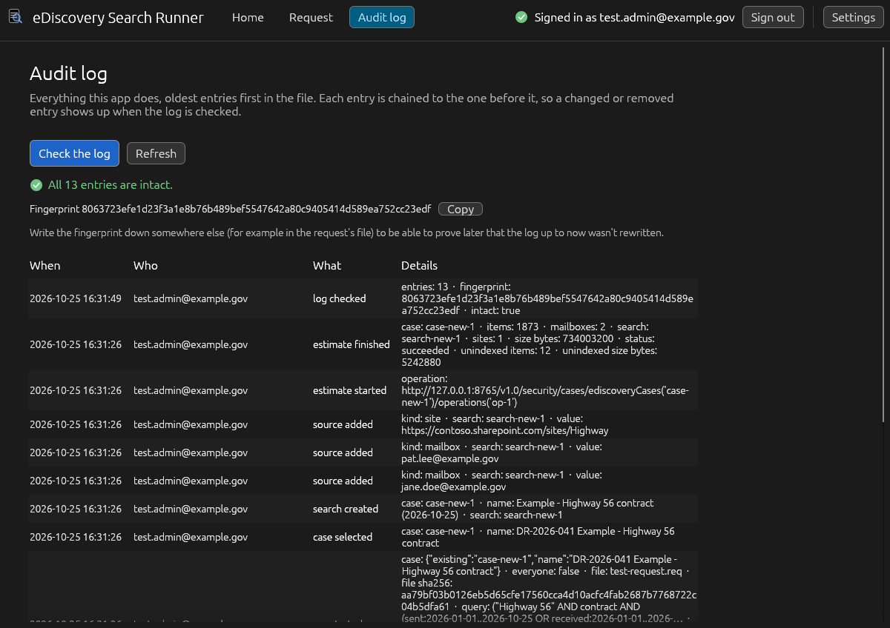
</p>

Every action is written to the log **before** the runner moves on, and nothing runs if the log can't be
written. Entries record who (the signed-in admin, or the computer account before sign-in), when (UTC), and the
details: the request file's name and SHA-256, the exact query, the case and search IDs, each mailbox and site,
names the admin left out, the estimate's results, sign-ins, sign-outs, settings changes and errors.

- **Tamper-evident.** Each entry is a JSON line holding the SHA-256 of the entry before it. **Check the log** walks
  the chain and names the first entry that was changed, removed or reordered.
- **Fingerprint.** The newest entry's hash. Write it down somewhere else (the request's file, an email) and the log
  up to that point can be proven unaltered later. Without that, someone who can write the file could rebuild the
  whole chain.
- **Format.** JSON Lines (`audit-log.jsonl`), so other tools can read it. Choose a shared, backed-up folder in
  Settings.
- **Purview keeps its own record too:** searches created through the API appear in Purview's audit log under the
  admin's account. See below for checking one against the other.

### Records in Microsoft 365

<p align="center">
  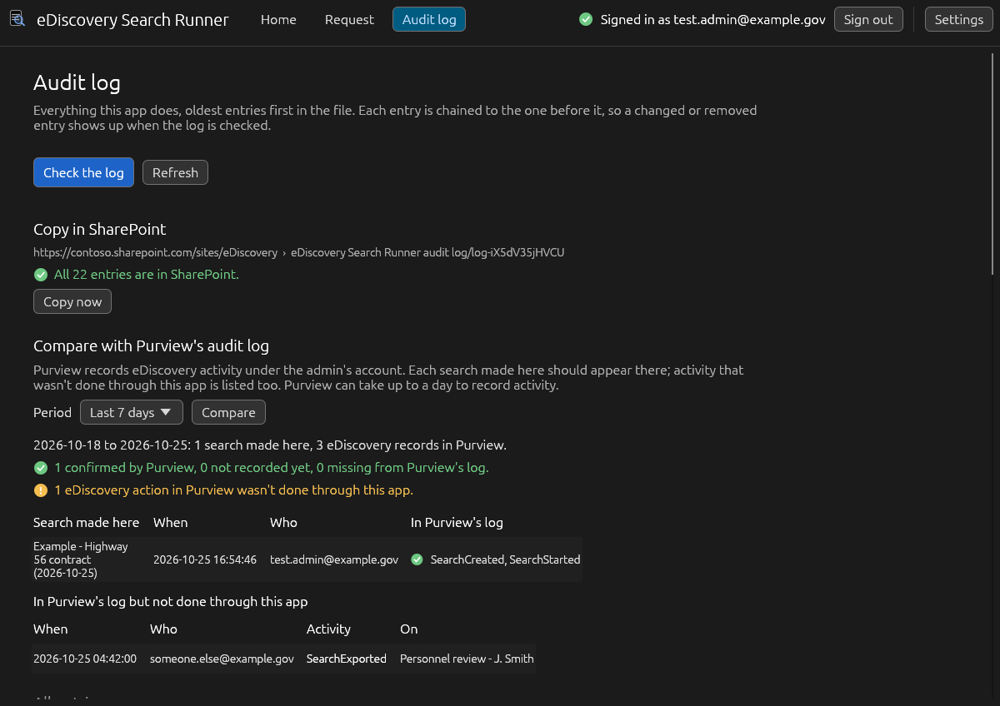
</p>

Apps can't write entries into Microsoft Entra's or Purview's audit logs, so the runner keeps its own log, and
then ties it to Microsoft 365 in two ways.

**A copy in SharePoint.** Every entry is also saved as a file in a SharePoint document library (Settings → **SharePoint
site**), one JSON file per entry, named `00000042-search_created.json`, in a folder for that runner PC's log
(`eDiscovery Search Runner audit log/log-<id>/`).

- **Exact lines.** Each file is the entry's exact line from the local log, hash chain included, so the copy can be
  checked on its own.
- **Never overwritten.** Uploads use "fail if it exists", so a file already in SharePoint is never replaced.
- **Uploaded as the admin,** so SharePoint's "Created by" shows who.
- **Catches up automatically.** While someone is signed in, new entries are copied as they're written, including
  ones logged before sign-in. If SharePoint can't be reached it tries again every minute. The failure is logged
  once, and the Audit log page shows how many entries are waiting.
- **Retention:** put a retention label on the folder or library (Microsoft Purview → Records management). A label
  that marks items as records makes the files undeletable and unchangeable for the retention period.

**Compare with Purview's audit log.** On the Audit log page, pick a period and choose **Compare**. The runner asks
Purview's audit log (the Microsoft 365 unified audit log) for its eDiscovery records over that period. It matches
them to each search the runner created, by the case and search IDs or names. Each search shows as:

- **Confirmed:** Purview has a matching record, and its activities are listed.
- **Not recorded yet:** less than a day old; Purview can take that long to record activity.
- **Missing:** older than a day, and Purview has no record of it.

eDiscovery activity Purview recorded that **wasn't** done through the runner is listed separately, for example a
search someone ran directly in the Purview portal. Each comparison's results are written to the runner's own log.

How long Microsoft keeps its records depends on licensing: Purview's audit log keeps 180 days by default, and 1 year
for users with E5 or Purview Suite licenses. An audit retention policy can keep eDiscovery records for up to 10 years
with the add-on license. Entra's sign-in logs are kept 7 or 30 days.

### Security

- **Sign-in** uses the OAuth 2.0 authorization code flow with PKCE in the admin's own browser, so MFA and
  Conditional Access apply as usual. The app is a public client: no secrets are stored.
- **Tokens** are kept in memory only, never written to disk. Closing the app or **Sign out** discards them.
- **It only talks to** `login.microsoftonline.com` and `graph.microsoft.com`.
- **Permissions** are delegated: the runner can do only what the signed-in admin can already do in Purview.

## Setting up the search runner

You need an account that can register apps and grant admin consent in Microsoft Entra ID.

1. **Register the app.** Entra admin center → **App registrations** → **New registration**.
   - Name: `eDiscovery Search Runner`. Supported account types: **this organizational directory only**.
   - Redirect URI: platform **Public client/native (mobile & desktop)**, URI `http://localhost`.
     (Any port is allowed for `http://localhost`; the runner picks a free one each time.)
2. **Permissions.** **API permissions** → **Add a permission** → **Microsoft Graph** → **Delegated**, then **Grant admin
   consent**:

   | Permission | For |
   |---|---|
   | `eDiscovery.ReadWrite.All` | creating cases and searches and running estimates |
   | `AuditLogsQuery.Read.All` | **Compare** with Purview's audit log |
   | `Sites.ReadWrite.All` | saving the log's copy to SharePoint |
   | `User.Read` | showing who signed in |

   All are delegated, so the runner can only do what the signed-in admin can already do.
3. **Purview role.** The admins who will run searches need the **eDiscovery Manager** role group (their own
   cases) or **eDiscovery Administrator** (all cases) in the Microsoft Purview portal → **Settings** → **Roles and
   scopes**.
   To use **Compare**, they also need permission to search the audit log: the **Audit Reader** role group, or any role
   group with the View-Only Audit Logs role.
4. **SharePoint.** Choose a site for the log's copy, such as the eDiscovery team's site. The admins need permission to
   add files there, and nobody else should be able to edit it. Optionally apply a retention label (see
   [Records in Microsoft 365](#records-in-microsoft-365)).
5. **Purview audit retention.** In Purview → **Audit** → **Audit retention policies**, add a policy for the
   eDiscovery record types, for as long as your records schedule requires.
6. **Settings in the runner.** Copy the registration's **Directory (tenant) ID** and **Application (client) ID**
   into **Settings**. Choose where the local audit log lives, and enter the SharePoint site.

Optional hardening: on the app's **Enterprise application**, set **Assignment required** to **Yes** and assign only
the eDiscovery admins, so nobody else can even sign in to it.

## How answers become KeyQL

[`src/query.rs`](src/query.rs) turns the answers into KeyQL, following Microsoft Learn's
*Keyword queries and search conditions for eDiscovery*:

| You answer… | The query gets… |
|---|---|
| Words and phrases, "all of these" | `"Highway 56" AND contract` (phrases quoted) |
| Words and phrases, "any of these" | `(budget OR "fiscal year")` |
| Only in the subject line or file title | `SubjectTitle:budget` on each word |
| Words close together | `(contract NEAR(5) breach)` |
| Leave out | one trailing `NOT (newsletter OR digest)` |
| Dates: "This year" | `sent:2026-01-01..2026-10-25 OR received:… OR LastModifiedTime:…` |
| Email / Teams / Files | `kind:email`, `kind:microsoftteams`, `kind:im`, `kind:docs`, `kind:meetings`… |
| From / to / involving | `from:`, `recipients:`, `participants:` |
| Attachments, file types, names | `HasAttachment:true`, `FileExtension:dwg`, `FileName:…` |
| Authors, importance, size | `author:`, `importance:high`, `size>2097152` (bytes) |
| Sensitive information | `SensitiveType:"U.S. Social Security Number (SSN)"` |

Rules it always follows:

- Operators are upper case (`AND`, `OR`, `NOT`, `NEAR(n)`).
- Several values in one condition are joined with `OR`, and conditions are joined with `AND`.
- Dates are **absolute**. "Last 30 days" is fixed on the day the file is saved, so the same search can be run again later and give the same results.

## The Minnesota 10-business-day deadline

When the request is from **someone asking for data about themselves**, the app works out the response deadline
under [Minn. Stat. § 13.04, subd. 3](https://www.revisor.mn.gov/statutes/cite/13.04): comply immediately if
possible, or within ten days of the request, excluding Saturdays, Sundays and legal holidays.

- **Day one is the next business day** after the request was received, so a request received on Friday,
  October 23, 2026 is due Friday, November 6, 2026.
- **Legal holidays** are those in [Minn. Stat. § 645.44, subd. 5](https://www.revisor.mn.gov/statutes/cite/645.44):
  New Year's Day, Martin Luther King's Birthday, Washington's and Lincoln's Birthday, Memorial Day, Juneteenth,
  Independence Day, Labor Day, Veterans Day, Thanksgiving and Christmas. When New Year's Day, Juneteenth,
  Independence Day, Veterans Day or Christmas falls on a Saturday it's observed on Friday, and on a Sunday it's
  observed on Monday.
- **Indigenous Peoples Day and the Friday after Thanksgiving** are holidays only if the office chooses to observe
  them, so they're counted as workdays (the earlier, safer deadline) unless you tick them in **Settings**.
- The deadline appears on the first page, in "Your request so far", in the email to the IT Director and in the
  copy for your records. **Ask the IT Director for results by then** sets it as the deadline for results.
- You're warned when the deadline has passed, or when results are asked for after it.

This is a guide, not legal advice. Public data requests under § 13.03 have no fixed number of days, so no deadline
is shown for them.

## Checks

Saving is blocked when:

- there's nothing to search for, or there are only things to leave out
- a date can't be read

You're warned (but can still save) about:

- no one chosen to search (no people, places or "Search everyone")
- names in sender and recipient filters, where they go into the search itself and can match the wrong person
- a `*` at the start of a word (Purview only supports it at the end)
- dates in the future
- sensitive-information filters on email (they only work on OneDrive and SharePoint files)
- a query over Purview's 4,000-character limit

## Design basis

The layout follows published form-usability guidance:

- **GOV.UK Design System:** one thing per page, check answers, error summary and error messages
- **NN/g:** wizards, required fields, placeholders, toggles vs. checkboxes
- **USWDS:** date inputs and date ranges
- **WCAG 2.2:** contrast, not relying on color alone, keyboard use

In practice:

- Labels and hints sit above the fields, and examples stay visible.
- Optional sections stay collapsed until needed.
- Problems appear once you've moved on from a step, both on the step and in a summary on the check page.
- Every problem has an icon and words, so color is never the only signal.
- Hint text has at least 7:1 contrast and field borders at least 3:1, in both color schemes.
- Anything still typed in a box is kept when you change page.

## Getting started

You need a Rust toolchain: <https://rustup.rs>.

### Desktop apps

```sh
git clone https://github.com/simontemplarST/keyql-builder.git
cd keyql-builder
cargo run --release                      # the request builder
cargo run --release -- --example         # ... starting on the check page with a sample request
cargo run --release -p keyql-runner      # the search runner
cargo test --workspace                   # every test: query, request file, sign-in, Graph calls, audit log
```

The runner's tests use local stand-ins for Microsoft's sign-in and Graph services and don't touch a real tenant.
They cover a full sign-in, a full create-and-estimate run, Purview audit log queries, and copying the log to
SharePoint (only new entries, never overwriting).

The release binary is in `target/release/` (`keyql-builder.exe` on Windows, which opens no console window).
Answers are saved in `%APPDATA%\keyql-builder\` on Windows, `~/Library/Application Support/keyql-builder/`
on macOS and `~/.local/share/keyql-builder/` on Linux.

### In a browser

The same code builds to WebAssembly with [trunk](https://trunkrs.dev):

```sh
rustup target add wasm32-unknown-unknown
cargo install --locked trunk

trunk serve --release            # http://127.0.0.1:8080   (add ?example for the sample request)
trunk build --release            # static files in dist/
```

In the browser, **Save request file…** downloads the `.req` file, and **Show the file in its folder** is hidden.
The search runner is desktop only.

> The post-build hook in [`Trunk.toml`](Trunk.toml) fixes the size the loading bar counts to (trunk records the
> size from before `wasm-opt`). It uses `sh`, `wc` and GNU `sed`; on macOS install `gsed` or drop the hook (the bar
> then stops short of 100% before the app starts).

## Hosting the web version

`dist/` is a plain static site: `index.html`, one `.js`, one `.mjs` (the loader) and one `.wasm`.
Any static web server works, with two things to get right:

1. **MIME types.** `.wasm` must be `application/wasm`, and `.mjs` must be a JavaScript type. nginx's default `mime.types` has no `.mjs`.
2. **Compression.** The `.wasm` is about 8 MB, or about 3 MB with gzip or zstd. Turn compression on, here or in a proxy in front.

A minimal nginx `server` block:

```nginx
server {
    listen 80;
    root /usr/share/nginx/html;          # contents of dist/

    gzip on;
    gzip_types application/wasm text/javascript application/javascript;

    # mime.types has no .mjs; known types still win, so this only affects the loader.
    location ~* "-[0-9a-f]{12,16}(_bg)?\.(js|mjs|wasm)$" {
        default_type text/javascript;
        add_header Cache-Control "public, max-age=31536000, immutable";   # file names carry a content hash
    }
    location / {
        add_header Cache-Control "no-cache";
        try_files $uri /index.html;
    }
}
```

`index.html` already carries the Content-Security-Policy in a `<meta>` tag. Sending the same policy as a
header as well is a good idea.

## Project layout

```text
src/lib.rs          shared by both apps:
src/query.rs          request model, KeyQL generator, plain-English summary, email text, checks
src/reqfile.rs        the .req request file: layout, checksum, reading and writing
src/ui_kit.rs         the shared look: colors, drawn badges, callouts, cards, step list
src/app.rs          the request builder: wizard UI, chip and date inputs, saving, settings
src/main.rs         the builder's desktop window and browser entry point
index.html          the builder's web page: loading screen and Content-Security-Policy
loader.mjs          download progress for the loading screen (trunk initializer)
Trunk.toml          web build settings and the post-build hook
runner/src/auth.rs  sign-in: OAuth 2.0 + PKCE with a loopback redirect, token refresh
runner/src/graph.rs the Microsoft Graph eDiscovery calls and the create-and-estimate run
runner/src/plan.rs  turning a request into mailboxes, sites and Purview names
runner/src/audit.rs the hash-chained audit log
runner/src/mirror.rs   the audit log's copy in SharePoint
runner/src/purview.rs  comparing the log with Purview's audit log
runner/src/app.rs   the runner's screens
docs/               screenshots and the sample request file
```

Built with [egui / eframe](https://github.com/emilk/egui), [chrono](https://github.com/chronotope/chrono),
[rfd](https://github.com/PolyMeilex/rfd) for file dialogs, [trunk](https://trunkrs.dev) for the web build, and in the
runner [ureq](https://github.com/algesten/ureq) (with rustls) and [sha2](https://github.com/RustCrypto/hashes).

## License

MIT. See [LICENSE](LICENSE).

*Not affiliated with Microsoft. Microsoft Purview is a trademark of Microsoft Corporation.*
